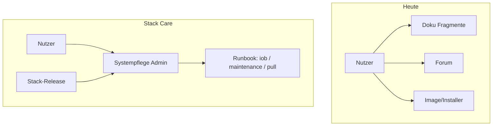

# ioBroker Stack Care – Ausarbeitung (Argumentationsgrundlage)

**Stand:** 23. November 2026  
**Status:** Entwurf zur Abstimmung – **noch keine** gemeinsame Entscheidung der Community, nichts Offizielles von ioBroker.  
**Ziel:** Lesbar in 15–20 Minuten; zum **Argumentieren** mit Image-Pflege, Core und Forum.

**Dokumente:**

| Datei | Inhalt |
|-------|--------|
| **Dieses Papier** | Kurz, argumentierbar |
| `iobroker-stack-care-konzept.md` | Vollständige technische Ausführung (§ 1–15) |
| `iobroker-stack-care-review.md` | Sinn, Aufwand, Image-Historie |
| Forum-Kurztext | nur [im Forum](https://forum.iobroker.net/topic/85889/updates-systempflege-geht-das-für-normalnutzer-einfacher) |
| `iobroker-stack-care-admin-mockup.md` | UI-Skizze für P2 (optional) |

---

## 1. Executive Summary

**Problem:** Viele Nutzer wollen mit ioBroker ihr Zuhause automatisieren, nicht Linux, Node, Docker-Tags und Update-Reihenfolgen pflegen. Die Hilfen (Doku, Forum, `iob fix`, Docker-Image) existieren einzeln – es fehlt ein **verbindliches Betriebsmodell**: *Ist meine Installation in Ordnung, und wenn nein, was ist genau der nächste Schritt?*

**Vorschlag:** **Stack Care** (*Untertitel: **empfohlener Stack / Release-Orientierung***) – kein neues Produkt neben ioBroker, sondern eine **Schicht**:

- **Stack-Release:** geprüfte Kombination (z. B. offizielles Docker-Image-Tag + getestete Controller-/Adapter-Policies), veröffentlicht als klare Empfehlung.
- **Admin „Systempflege“** (perspektivisch): wenige Zustände statt verstreuter Tabs und Forenrecherche.
- **Supported vs. Best effort:** volles Versprechen nur auf **benanntem** Installationspfad; andere Wege bleiben legitim, aber ohne „wartungsarm“-Marketing.

**Nicht neu:** Docker-Image, js-controller Auto-Upgrade, BackItUp, `iob fix`, `iob nodejs-update`, `maintenance` im Container.

**Neu:** Abstimmung, Manifest, Nutzersprache, Backup vor Gefährlichem als Ablauf, Governance.

**Minimalstart (P1):** Ohne Core-Code – Release-Text + feste Versionen + eine Upgrade-Story pro Profil (Image-Release bzw. Installer-Doku) – um **Mitwirkung** zu testen, nicht gleich UI zu bauen.

**Ohne Mitwirkung von Image-Pflege und Core:** bleibt Analyse – wie frühere Image-Projekte ohne Nachfolge.

### 1.1 Was Stack Care **ist** – und was **nicht**

| **Stack Care ist …** | **Stack Care ist nicht …** |
|----------------------|----------------------------|
| Release-Orientierung: *welche Kombination* (Image-Tag, Policies, Reihenfolge) für einen **benannten** Supported-Pfad **empfohlen** ist | **Kein** neuer **Updater**, der Befehle **ausführt** (`apt`, `iobroker upgrade --all`, automatischer Docker-Pull) |
| Abstimmung Image ↔ Core ↔ Community über **eine** Upgrade-Story pro Stack-Release (P1 zuerst als **Text** im Release bzw. in der Installer-Doku) | **Kein** Ersatz für **Full Updater**, **Ultimate Updater** oder eigene Host-Skripte – die führen Updates weiterhin **aus**; Stack Care kann ihnen sagen, **welcher** Stand empfohlen ist |
| Perspektivisch (P2+): **eine** Admin-Antwort („Systempflege“, vier Zustände) statt Forenrecherche | **Kein** Versprechen, **jede** Installation (LXC, Proxmox, Synology, `latest`, Mischbetrieb) **voll** zu orchestrieren – nur **Supported** eng, Rest **Best effort** |
| Nutzung **bestehender** Werkzeuge (`iobroker upgrade`, `maintenance`, BackItUp, Image-Pull) über **Runbooks** – nicht neues Backend | **Kein** offizielles ioBroker-Projekt **bis** Mitwirkung da ist – heute **RFC-Entwurf** zum Diskutieren |
| Profilbasiert: **Docker-Image** (`docker`) und **Installer auf Debian/Raspberry** (`debian-installer`) sind gleichwertige Profile im selben Stack-Release | **Kein** „pflegefrei“ – Ziel ist **wartungsarm** mit Backup-Pflicht bei Majors |
| | **Nicht** an Docker gebunden – welches Profil zuerst pilotiert wird, hängt davon ab, wer zuerst mitmacht (Image-Pflege oder Core/Installer) |

**Merksatz für das Forum:** Stack Care **entscheidet und erklärt** (empfohlener Stack); bestehende Updater und CLI **führen aus**.

---

## 2. Warum das Problem strukturell ist (nicht nur „User sind faul“)

### 2.1 Mehrschichtige Pflege

| Ebene | Typische Nutzerfrage |
|-------|----------------------|
| Host / Image / OS | Muss ich `apt`, neuen Container, `latest` ziehen? |
| Node | Passt meine Version noch? |
| js-controller | Major jetzt oder später? |
| Adapter (npm) | Alle 40 installieren? Nur rote? |

Jede Ebene hat **eigene** gute Doku. **Keine** zentrale Instanz sagt: *bei deinem Pfad, heute, nur das.*

### 2.2 Beobachtbare Folgen (Forum, Community)

- Wiederkehrende Threads: Reihenfolge, Node kaputt, nach OS-Update tot, `latest`-Überraschung.
- Umsteiger-Begründungen oft: zu technisch, Updates zu riskant – nicht „zu wenig Adapter“.
- Support-Last durch **dieselben** Pflege-Muster.
- Diskussion um Verbreitung und Neuinstallationen steht **nicht** im Widerspruch zur Beobachtung, dass genau die **Pflege-Hürde** viele abhängt (Details: öffentliche Statistik, freiwillige Meldung – [iobroker.com/statistics](https://www.iobroker.com/statistics?lang=de)).

### 2.3 Wettbewerbskontext (qualitativ)

Andere Plattformen verkaufen **Onboarding + Systemwartung** als Produktwahrnehmung. ioBroker ist bewusst offen und flexibel – Stärke und gleichzeitig **Pflege bleibt beim Einzelnen**, wenn kein Gegenmodell existiert.

---

## 3. Was heute schon da ist (Argument: wir erfinden nichts neu)

| Baustein | Nutzen heute |
|----------|----------------|
| **Offizielles Docker-Image** (buanet) | Bündelt OS/Node/ioBroker-Basis |
| **js-controller ≥ 6** | Auto-Adapter-Upgrade, Notifications |
| **Admin** | Adapter, Host, Updates |
| **BackItUp** | Backup/Restore |
| **`iob fix`, `iob nodejs-update`, `iob diag`** | Reparatur/Node auf **Bare-Metal-Pfad** |
| **`maintenance` im Image** | Controller-Upgrade im Container |
| **Image-Doku** | Tags, kein `latest` empfohlen |

**Lücke:** Kein **gemeinsames Release-Versprechen** an den Nutzer und keine **eine** Oberflächen-Antwort.

### 3.1 Ökosystem: Pflege-Werkzeuge (wer macht was?)

Im Forum laufen Diskussionen oft um **ausführende** Hilfen. Stack Care gehört **nicht** in dieselbe Schublade – es ergänzt sie.

| Werkzeug | Was es tut | Typischer Nutzerkontext | Rolle von Stack Care |
|----------|------------|-------------------------|----------------------|
| **Full Updater** (Community-**Wartungsskript**, z. B. Thomas) | `apt` + `iob stop` + Node-Capabilities + `iobroker upgrade` auf **Bare-Metal-Debian** | Debian-Host, oft **ohne** Docker | Im Profil `debian-installer` ein möglicher **Ausführer**: Stack Care sagt, *welche* Kombination empfohlen ist, das Skript kann sie umsetzen – Partner, kein Konkurrent |
| **Ultimate Updater** (Community) | Gebündelt Host/Container/apt/Adapter (z. B. Proxmox/LXC) | Eigene Homelab-Konstrukte | **Best effort**; eigene Doku – Stack Care verspricht hier **nichts** |
| **`iobroker upgrade` / Admin-Adapter-Updates** | Controller- und Adapter-Updates **in** ioBroker | Überall | **Ausführung** – Teil jedes Stack-Runbooks |
| **`maintenance` (offizielles Docker-Image)** | Controller-Upgrade **im Container** | Offizielles Image | **Ausführung** im Docker-Profil – Schritt in Release-Story |
| **`iob nodejs-update`, `iob fix`, `iob diag`** | Node/Reparatur auf **Host-Pfad** (nicht Docker-intern) | Installer / Bare Metal | Runbook-Schritte, wenn Profil `debian-installer` |
| **BackItUp** | Backup/Restore | Überall | **Gate** vor riskanten Schritten (P3) |
| **Stack Care** | Empfohlene **Kombination** + Release-Text (P1); später Status vs. Manifest (P2) | Supported-Profile: offizielles **Docker-Image** und **Installer auf Debian/Raspberry** | **Empfehlung & Orientierung** – führt selbst **keine** Updates aus |

---

## 4. Was Stack Care konkret hinzufügt

| Element | Inhalt |
|---------|--------|
| **Stack-Release** | „Für Kanal `stable` gilt: Image-Tag X, Policies Y, Runbook Z“ – pro Release neu, keine starren Versionen im Konzept-PDF |
| **Profile** | `docker` (offizielles Image, Mitwirkung Image-Pflege) und `debian-installer` (Installer/`iob`, Mitwirkung Core) – Pilot-Reihenfolge offen |
| **Vier Zustände** | in Ordnung · unkritisch · Wartung · nicht supported |
| **Adapter** | Auto auf `live` patch/minor; beta/GitHub ausgenommen (ehrlicher Status) |
| **`iob`-Werkzeuge** | werden **aufgerufen**, nicht ersetzt (§ 14 Konzept) |
| **KI** | optional später, nur Erklärung – kein Autopilot |

---

## 5. Abgrenzung (gegen typische Einwände)

| Einwand | Antwort |
|---------|---------|
| „Das gibt’s schon als Docker“ | Image = **Hülle**; fehlt Release als **Nutzerprodukt** + Admin-Status |
| „Noch ein Adapter?“ | Bevorzugt **Admin + Host**; Adapter nur optional für schnelle UI |
| „Alle Installationen abdecken?“ | **Nein** – Supported eng, Rest Best effort |
| „Pflegefrei?“ | **Wartungsarm**: Backup, seltene Majors, sonst Ruhe |
| „KI löst’s“ | Nein – Runbooks und Releases zuerst |
| „Konflikt mit `iob fix`?“ | Stack **orchestriert**, CLI bleibt Ausführung |
| „Raspberry-Image war gescheitert“ | Lesson: **Governance**, nicht noch ein Artifact ohne Maintainer |

---

## 6. Governance – Antwort auf „Wer wartet das?“

### 6.1 Heute verteilt

Jeder Nutzer „wartet“ selbst – unsichtbar, uneinheitlich, teuer im Forum.

### 6.2 Ziel: gebündelt, klein, benannt

| Rolle | Aufgabe |
|--------|---------|
| **Image-Maintainer** | Basis Docker, Tags, CHANGELOG-Eintrag „empfohlener Stack“ |
| **Core (js-controller/Admin)** | Status, Policies, perspektivisch UI |
| **Release-Abstimmung** | Manifest je Freigabe, Tester |
| **Community** | Smoke-Test, Forum |

**Nicht:** ein Einzelner für alle User für immer (Raspberry-Image-Lektion).

**Exit:** Wenn Pflege wegfällt → kein falsches „grün“, Status Best effort / eingefrorenes Manifest.

### 6.3 Minimal verbindlich (P1)

Pro Release **ein** Absatz je Profil – **ohne** neue Software:

- **Docker:** im Image-Release empfohlenes Tag, Reihenfolge Backup → Adapter/Controller → ggf. Container neu erstellen.
- **Installer (Debian/Raspberry):** in der Installer-/Update-Doku empfohlene Node- und js-controller-Kombination, Reihenfolge Backup → `iob nodejs-update` → Controller → Adapter.

---

## 7. Phasen – was wann sinnvoll ist

| Phase | Ergebnis | Aufwand | Nutzen |
|-------|-----------|---------|--------|
| **P0** | RFC, dieses Papier | gering | Klarheit |
| **P1** | Doku + Release-Story (Image: Stack-Absatz, festes Tag, **eine** Upgrade-Reihenfolge) – **ohne** Core-Code | gering | **Beweis Mitwirkung** |
| **P2a** | Verständliche **Notifications** / Glocke: Pflege-Hinweise bündeln (z. B. „Backup alt“, optional später Host/OS-pending – **braucht** Host-Daten) | Core gering–mittel | Weniger versteckte Einzelmeldungen |
| **P2b** | Admin **„Systempflege“** read-only: Manifest laden, Ist vs. Empfehlung, **4 Zustände**, Backup-Alter | Core mittel | Sichtbarkeit „empfohlener Stack“ |
| **P3** | BackItUp-Gate, Wartungs-Assistent, sinnvolle Defaults (z. B. Auto-Adapter Nachts) | Core hoch | Laien bei Major |
| **P4** | Host recreate optional, Migration-Hinweise | heterogen | Komfort |

**Empfehlung:** Forum und Maintainer **erst** mit P0+P1 ansprechen. **P2b** (volles Manifest-UI) erst nach Zusage **und** geklärtem Manifest-Hosting; **P2a** kann **vor** P2b diskutiert werden (kleinerer Einstieg, kein vollständiges Stack-Manifest nötig).

**Abgrenzung P2a vs. P2b:** P2a = **Hinweise** über bestehendes Notification-System; P2b = **eine Seite** mit Stack-Status gegen zentrales Manifest – beides ist **kein** Updater.

---

## 8. Nutzer – vorher / nachher (nur Supported Stack)

| Situation | Vorher (typisch) | Nachher (Ziel) |
|-----------|------------------|----------------|
| Alltag | „Muss ich was mit Node machen?“ | „Alles ok“ oder klarer Schritt |
| Adapter | Viele gleichrangige Updates | Unkritisch automatisch/gebündelt |
| Major | Forum + Risiko | Assistent + Backup |
| Docker-Basis | `latest` / vergessen | festes Tag laut Release |
| GitHub-Adapter | verstecktes Risiko | „2 Adapter ausgenommen“ |

**Bleibt:** Backups, Bestätigung bei Major, Host bei neuem Image, Smart-Home-Logik, Sidecars (Z2M, Influx …) **nicht** automatisch im Stack.

---

## 9. Risiken (ehrlich)

| Risiko | Gegenmaßnahme |
|--------|----------------|
| Kein Mitwirkender Image/Core | nur Papier; P1 testet das |
| Erwartung „pflegefrei“ | Formulierung „wartungsarm“, Supported begrenzt |
| Watchtower + `latest` | Doku: abschalten |
| Docker + `iob nodejs-update` Host | Runbook: Schritt entfällt |
| Zwei Profile testen | Mit **einem** Profil pilotieren (das, für das zuerst eine Zusage kommt), das zweite danach |
| Maintainer burn-out | kleines P1, feste Release-Routine |

---

## 10. FAQ (für Diskussion)

**Ist das ein offizielles ioBroker-Projekt?**  
Nein – privater RFC-Entwurf zum Diskutieren; ob und wie etwas davon umgesetzt wird, hängt von Mitwirkung (Image-Pflege, Core, Community) ab.

**Ersetzt das Installer/Skript?**  
Nein – ergänzt mit **empfohlener Kombination**; Debian-Profil später optional.

**Was ist mit Synology, Windows, Unraid?**  
Docker auf Unraid kann Supported sein; native Pakete meist Best effort.

**Muss jeder migrieren?**  
Nein – Migration freiwillig für volles Versprechen.

**Was kostet das?**  
P1 hauptsächlich Zeit von Image + wenige Tester; P2+ Entwicklungszeit Core.

**Warum nicht nur Doku verbessern?**  
Doku **ist** Teil von P1; zusätzlich braucht es **eine** empfohlene Kombination und sichtbaren Status.

**Verdrängt das `iob fix`?**  
Nein – gleiche Schritte, eingeordnet.

---

## 11. Nächste Schritte (empfohlen)

**Reihenfolge flexibel:** öffentlicher Start kann über **GitHub** laufen; Forum nur als kurzer Verweis.

1. **GitHub (P0):** RFC-Dokumente im öffentlichen Repo (ohne interne Antwort-Vorlagen).  
2. **Anpassen:** Feedback über **Issues/Discussions** und/oder Forum-Thread einarbeiten.  
3. **Forum:** Kurzpost + **Link** zum Repo (siehe Forum-Thread in README).  
4. **Mitwirkung klären:** Ob **P1** (Stack-Absatz pro Release, feste Versionen, eine Upgrade-Reihenfolge) realistisch ist, braucht **Image-Pflege** (Profil Docker) bzw. **Core/Installer** (Profil Debian/Raspberry) – für P2+ in jedem Fall Core. Feedback dazu gern per **GitHub Issues/Discussions** in diesem Repo, im verlinkten Forum-Thread oder **direkt** an die jeweiligen Maintainer – je nachdem, welcher Kanal bei euch üblich ist.  
5. **Bei P1-Zusage:** ein konkretes Release (Image oder Installer-Doku) als Pilot + Erfolgskriterium (z. B. Stack-Absatz + Tester).  
6. **Ohne P1-Interesse:** Repo bleibt Analyse; kein großes Versprechen nach außen.

**Hinweis für Image-Pflege und Core:** Dieser RFC verlangt **keine** Sofortumsetzung. P1 ist bewusst minimal (Release-Text, kein Core-Code). Eine kurze Rückmeldung *machbar / nicht geplant / später* reicht, damit die Community nicht mit falschen Erwartungen bleibt.

---

## 12. Was bewusst **nicht** in dieser Ausarbeitung steht

Vollständiges JSON-Schema, API-Namen, rechtliche Texte, Englischspfad – siehe **`iobroker-stack-care-konzept.md`**. Admin-UI-Skizze: **`iobroker-stack-care-admin-mockup.md`** (optional, P2).

---

## 13. Kurzargument in drei Sätzen (zum Mitnehmen)

Viele Nutzer scheitern nicht an ioBroker als Automation, sondern an **mehrschichtiger Systempflege** ohne klare Priorität. Image, CLI und Controller können das technisch – aber ohne **gemeinsames Stack-Release und eine Admin-Antwort** bleibt jedes Update ein Lotteriespiel. Stack Care schlägt vor, **klein mit Release-Absprache zu beginnen** und erst dann UX zu bauen – damit es nicht wieder an **einem Image ohne Maintainer** hängen bleibt.

---

*Öffentlicher RFC-Entwurf – Stand im Git-Repository.*