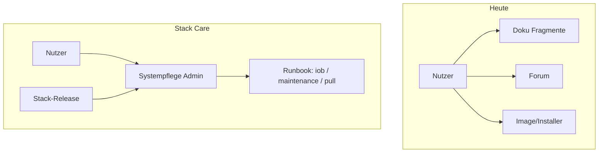

# ioBroker Stack Care – Ausarbeitung (Argumentationsgrundlage)

**Stand:** November 2026  
**Status:** Entwurf zur Abstimmung – **noch keine** gemeinsame Entscheidung der Community, nichts Offizielles von ioBroker.  
**Ziel:** Lesbar in 15–20 Minuten; zum **Argumentieren** mit Image-Pflege, Core und Forum.

**Dokumente:**

| Datei | Inhalt |
|-------|--------|
| **Dieses Papier** | Kurz, argumentierbar |
| `iobroker-stack-care-konzept.md` | Vollständige technische Ausführung (§ 1–15) |
| `iobroker-stack-care-review.md` | Sinn, Aufwand, Image-Historie |
| `iobroker-stack-care-forum-post.md` | Geposteter Forumskurztext (Archiv) |
| `iobroker-stack-care-admin-mockup.md` | UI-Skizze für P2 (optional) |

---

## 1. Executive Summary

**Problem:** Viele Nutzer wollen mit ioBroker ihr Zuhause automatisieren, nicht Linux, Node, Docker-Tags und Update-Reihenfolgen pflegen. Die Hilfen (Doku, Forum, `iob fix`, Docker-Image) existieren einzeln – es fehlt ein **verbindliches Betriebsmodell**: *Ist meine Installation in Ordnung, und wenn nein, was ist genau der nächste Schritt?*

**Vorschlag:** **Stack Care** – kein neues Produkt neben ioBroker, sondern eine **Schicht**:

- **Stack-Release:** geprüfte Kombination (z. B. offizielles Docker-Image-Tag + getestete Controller-/Adapter-Policies), veröffentlicht als klare Empfehlung.
- **Admin „Systempflege“** (perspektivisch): wenige Zustände statt verstreuter Tabs und Forenrecherche.
- **Supported vs. Best effort:** volles Versprechen nur auf **benanntem** Installationspfad; andere Wege bleiben legitim, aber ohne „wartungsarm“-Marketing.

**Nicht neu:** Docker-Image, js-controller Auto-Upgrade, BackItUp, `iob fix`, `iob nodejs-update`, `maintenance` im Container.

**Neu:** Abstimmung, Manifest, Nutzersprache, Backup vor Gefährlichem als Ablauf, Governance.

**Minimalstart (P1):** Ohne Core-Code – Release-Text + festes Tag + eine Upgrade-Story pro Image – um **Mitwirkung** zu testen, nicht gleich UI zu bauen.

**Ohne Mitwirkung von Image-Pflege und Core:** bleibt Analyse – wie frühere Image-Projekte ohne Nachfolge.

---

## 2. Warum das Problem strukturell ist (nicht nur „User sind faul“)

### 2.1 Mehrschichtige Pflege

| Ebene | Typische Nutzerfrage |
|-------|----------------------|
| Host / Image / OS | Muss ich `apt`, neuen Container, `latest` ziehen? |
| Node | Passt meine Version noch? |
| js-controller | Major jetzt oder später? |
| Adapter (npm) | Alle 40 installieren? Nur rote? |

Jede Ebene hat **eigene** gute Doku. **Keine** zentrale Instanz sagt: *bei deinem Pfad, heute, nur das.*

### 2.2 Beobachtbare Folgen (Forum, Community)

- Wiederkehrende Threads: Reihenfolge, Node kaputt, nach OS-Update tot, `latest`-Überraschung.
- Umsteiger-Begründungen oft: zu technisch, Updates zu riskant – nicht „zu wenig Adapter“.
- Support-Last durch **dieselben** Pflege-Muster.
- Diskussion um Verbreitung und Neuinstallationen steht **nicht** im Widerspruch zur Beobachtung, dass genau die **Pflege-Hürde** viele abhängt (Details: öffentliche Statistik, freiwillige Meldung – [iobroker.com/statistics](https://www.iobroker.com/statistics?lang=de)).

### 2.3 Wettbewerbskontext (qualitativ)

Andere Plattformen verkaufen **Onboarding + Systemwartung** als Produktwahrnehmung. ioBroker ist bewusst offen und flexibel – Stärke und gleichzeitig **Pflege bleibt beim Einzelnen**, wenn kein Gegenmodell existiert.

---

## 3. Was heute schon da ist (Argument: wir erfinden nichts neu)

| Baustein | Nutzen heute |
|----------|----------------|
| **Offizielles Docker-Image** (buanet) | Bündelt OS/Node/ioBroker-Basis |
| **js-controller ≥ 6** | Auto-Adapter-Upgrade, Notifications |
| **Admin** | Adapter, Host, Updates |
| **BackItUp** | Backup/Restore |
| **`iob fix`, `iob nodejs-update`, `iob diag`** | Reparatur/Node auf **Bare-Metal-Pfad** |
| **`maintenance` im Image** | Controller-Upgrade im Container |
| **Image-Doku** | Tags, kein `latest` empfohlen |

**Lücke:** Kein **gemeinsames Release-Versprechen** an den Nutzer und keine **eine** Oberflächen-Antwort.

---

## 4. Was Stack Care konkret hinzufügt

| Element | Inhalt |
|---------|--------|
| **Stack-Release** | „Für Kanal `stable` gilt: Image-Tag X, Policies Y, Runbook Z“ – pro Release neu, keine starren Versionen im Konzept-PDF |
| **Profile** | `docker` (buanet Pflicht) optional später `debian-installer` |
| **Vier Zustände** | in Ordnung · unkritisch · Wartung · nicht supported |
| **Adapter** | Auto auf `live` patch/minor; beta/GitHub ausgenommen (ehrlicher Status) |
| **`iob`-Werkzeuge** | werden **aufgerufen**, nicht ersetzt (§ 14 Konzept) |
| **KI** | optional später, nur Erklärung – kein Autopilot |

---

## 5. Abgrenzung (gegen typische Einwände)

| Einwand | Antwort |
|---------|---------|
| „Das gibt’s schon als Docker“ | Image = **Hülle**; fehlt Release als **Nutzerprodukt** + Admin-Status |
| „Noch ein Adapter?“ | Bevorzugt **Admin + Host**; Adapter nur optional für schnelle UI |
| „Alle Installationen abdecken?“ | **Nein** – Supported eng, Rest Best effort |
| „Pflegefrei?“ | **Wartungsarm**: Backup, seltene Majors, sonst Ruhe |
| „KI löst’s“ | Nein – Runbooks und Releases zuerst |
| „Konflikt mit `iob fix`?“ | Stack **orchestriert**, CLI bleibt Ausführung |
| „Raspberry-Image war gescheitert“ | Lesson: **Governance**, nicht noch ein Artifact ohne Maintainer |

---

## 6. Governance – Antwort auf „Wer wartet das?“

### 6.1 Heute verteilt

Jeder Nutzer „wartet“ selbst – unsichtbar, uneinheitlich, teuer im Forum.

### 6.2 Ziel: gebündelt, klein, benannt

| Rolle | Aufgabe |
|--------|---------|
| **Image-Maintainer** | Basis Docker, Tags, CHANGELOG-Eintrag „empfohlener Stack“ |
| **Core (js-controller/Admin)** | Status, Policies, perspektivisch UI |
| **Release-Abstimmung** | Manifest je Freigabe, Tester |
| **Community** | Smoke-Test, Forum |

**Nicht:** ein Einzelner für alle User für immer (Raspberry-Image-Lektion).

**Exit:** Wenn Pflege wegfällt → kein falsches „grün“, Status Best effort / eingefrorenes Manifest.

### 6.3 Minimal verbindlich (P1)

Pro Image-Release **ein** Absatz: empfohlenes Tag, Reihenfolge Backup → Adapter/Controller → ggf. recreate – **ohne** neue Software.

---

## 7. Phasen – was wann sinnvoll ist

| Phase | Ergebnis | Aufwand | Nutzen |
|-------|-----------|---------|--------|
| **P0** | RFC, dieses Papier | gering | Klarheit |
| **P1** | Doku + Release-Story | gering | **Beweis Mitwirkung** |
| **P2** | Admin liest Manifest, 4 Zustände | Core mittel | Sichtbarkeit |
| **P3** | BackItUp-Gate, Assistent | Core hoch | Laien |
| **P4** | Host recreate optional | heterogen | Komfort |

**Empfehlung:** Forum und Maintainer **erst** mit P0+P1 ansprechen; P2 erst nach Zusage.

---

## 8. Nutzer – vorher / nachher (nur Supported Stack)

| Situation | Vorher (typisch) | Nachher (Ziel) |
|-----------|------------------|----------------|
| Alltag | „Muss ich was mit Node machen?“ | „Alles ok“ oder klarer Schritt |
| Adapter | Viele gleichrangige Updates | Unkritisch automatisch/gebündelt |
| Major | Forum + Risiko | Assistent + Backup |
| Docker-Basis | `latest` / vergessen | festes Tag laut Release |
| GitHub-Adapter | verstecktes Risiko | „2 Adapter ausgenommen“ |

**Bleibt:** Backups, Bestätigung bei Major, Host bei neuem Image, Smart-Home-Logik, Sidecars (Z2M, Influx …) **nicht** automatisch im Stack.

---

## 9. Risiken (ehrlich)

| Risiko | Gegenmaßnahme |
|--------|----------------|
| Kein Mitwirkender Image/Core | nur Papier; P1 testet das |
| Erwartung „pflegefrei“ | Formulierung „wartungsarm“, Supported begrenzt |
| Watchtower + `latest` | Doku: abschalten |
| Docker + `iob nodejs-update` Host | Runbook: Schritt entfällt |
| Zwei Profile testen | Debian erst nach Docker-P1 |
| Maintainer burn-out | kleines P1, feste Release-Routine |

---

## 10. FAQ (für Diskussion)

**Ist das ein offizielles ioBroker-Projekt?**  
Nein – privater RFC-Entwurf zum Diskutieren; ob und wie etwas davon umgesetzt wird, hängt von Mitwirkung (Image-Pflege, Core, Community) ab.

**Ersetzt das Installer/Skript?**  
Nein – ergänzt mit **empfohlener Kombination**; Debian-Profil später optional.

**Was ist mit Synology, Windows, Unraid?**  
Docker auf Unraid kann Supported sein; native Pakete meist Best effort.

**Muss jeder migrieren?**  
Nein – Migration freiwillig für volles Versprechen.

**Was kostet das?**  
P1 hauptsächlich Zeit von Image + wenige Tester; P2+ Entwicklungszeit Core.

**Warum nicht nur Doku verbessern?**  
Doku **ist** Teil von P1; zusätzlich braucht es **eine** empfohlene Kombination und sichtbaren Status.

**Verdrängt das `iob fix`?**  
Nein – gleiche Schritte, eingeordnet.

---

## 11. Nächste Schritte (empfohlen)

**Reihenfolge flexibel:** öffentlicher Start kann über **GitHub** laufen; Forum nur als kurzer Verweis. Privat-Mail an Image/Core **optional und zeitlich unabhängig**.

1. **GitHub (P0):** RFC-Dokumente im öffentlichen Repo (ohne interne Antwort-Vorlagen).  
2. **Anpassen:** Feedback über **Issues/Discussions** und/oder Forum-Thread einarbeiten.  
3. **Forum:** Kurzpost + **Link** zum Repo (siehe Forum-Thread in README).  
4. **Optional privat (nicht Voraussetzung):** Image-Pflege / Core ansprechen – **P1 Ja/Nein?** (siehe unten „Privat-Mail“).  
5. **Bei P1-Ja:** ein konkretes Image-Release als Pilot + Erfolgskriterium (z. B. Stack-Absatz + Tester).  
6. **Bei P1-Nein / kein Interesse:** Repo bleibt Analyse; kein großes Versprechen.

### Privat-Mail an Image-Pflege – wofür?

**Nicht** für die Community sichtbar. **Zweck:** vor oder parallel zum öffentlichen Diskurs **ohne Foren-Öffentlichkeit** klären, ob ein **Minimal-Pilot (P1)** realistisch ist: z. B. ein Absatz „empfohlener Stack“ pro Image-Release, festes Tag, eine Upgrade-Reihenfolge. Antworten *Ja / Nein / später* steuern, ob du im Forum **konkret nach Mitmachern** fragst oder nur das **Problem** validierst. Wenn du erst GitHub + Forum machst und Mail **Monate später** – völlig in Ordnung.

---

## 12. Was bewusst **nicht** in dieser Ausarbeitung steht

Vollständiges JSON-Schema, API-Namen, rechtliche Texte, Englischspfad – siehe **`iobroker-stack-care-konzept.md`**. Admin-UI-Skizze: **`iobroker-stack-care-admin-mockup.md`** (optional, P2).

---

## 13. Kurzargument in drei Sätzen (zum Mitnehmen)

Viele Nutzer scheitern nicht an ioBroker als Automation, sondern an **mehrschichtiger Systempflege** ohne klare Priorität. Image, CLI und Controller können das technisch – aber ohne **gemeinsames Stack-Release und eine Admin-Antwort** bleibt jedes Update ein Lotteriespiel. Stack Care schlägt vor, **klein mit Release-Absprache zu beginnen** und erst dann UX zu bauen – damit es nicht wieder an **einem Image ohne Maintainer** hängen bleibt.

---

*Interne Arbeitsunterlage. Bei Weitergabe Version und Stand angeben.*