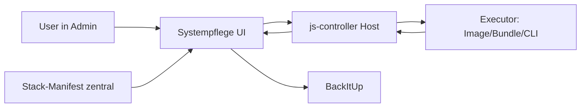

# ioBroker Stack Care – Konzept (User-first)

**Stand:** November 2026  
**Nicht Ziel:** Abdeckung aller möglichen Hostszenarien; nicht ein persönliches Homelab-Setup dokumentieren.  
**Argumentation (vor Forum):** `iobroker-stack-care-ausarbeitung.md` – **zuerst lesen** für Überblick.  
**Forum-Diskussion (nur Problem/Ziel):** `iobroker-stack-care-forum-einstieg.md`  
**Review Sinn/Machbarkeit/Aufwand:** `iobroker-stack-care-review.md`  
**Core/Admin-Gespräch (P2):** `iobroker-stack-care-core-checkliste.md`  
**Konstellationen Review 2:** § 15 unten

---

## Hauptproblem: Dauerhafte Systempflege

ioBroker ist für viele Nutzer **kein Server-Projekt**, sondern **Hausautomation**. Trotzdem werden sie dauerhaft in **Systemadministration** gezogen:

| Was der User eigentlich machen will | Was er zusätzlich ständig mitbekommt |
|-------------------------------------|--------------------------------------|
| Geräte anbinden, Regeln, Szenen | Node.js-Versionen, LTS, Ende-of-Life |
| „Läuft mein Zuhause noch?“ | Betriebssystem, Pakete, Docker-Tags |
| Gelegentlich Adapter aktualisieren | js-controller, npm, Reihenfolge der Schritte |
| Vertrauen ins System | Foren, widersprüchliche Anleitungen, Angst vor dem nächsten Update |

**Das Hauptproblem ist nicht ein fehlender Adapter**, sondern die **Daueraufgabe Pflege**: Updates kommen auf **mehreren Ebenen gleichzeitig**, ohne **eine verbindliche Antwort** „Was ist bei *meiner* Installation jetzt nötig – und in welcher Reihenfolge?“

### Folgen (für Community und User gleichermaßen)

1. **Aufschieben** → Sicherheits- und Kompatibilitätslücken; irgendwann ein großer, riskanter Sprung.  
2. **Ungeordnet updaten** → Ausfall, Adapter tot, Datenstress – genau dann, wenn „es eben laufen sollte“.  
3. **Frust und Abwanderung** → „ioBroker ist mir zu technisch“, obwohl der Kern (Automation) passt.  
4. **Support-Last** → dieselben Node-/Backup-/Reihenfolge-Fälle im Forum, weil es **kein gemeinsames Betriebsmodell** gibt.

### Was das Konzept dagegen setzt

Nicht „noch mehr Doku“, sondern **Wartung als Produkt**:

- **Seltene, geprüfte Stack-Releases** statt permanente Eigenverantwortung für jede Schicht.  
- **Eine Admin-Antwort** auf Pflege (vier Zustände), nicht zehn Dokumente.  
- **Automatik für Unkritisches**; **geführte Wartung** für Kritisches – mit Backup-Pflicht.  
- **Ein offizieller Weg** mit klarem Versprechen; andere Wege bleiben möglich, aber ohne „du musst dich um nichts kümmern“.

**Messgröße für Erfolg:** User müssen **nicht mehr regelmäßig** über Node/OS/Image nachdenken; sie sehen nur noch **„alles ok“** oder **„hier ein klarer Schritt“**.

---

## 1. Personas & Schmerzpunkte (Ausprägungen des Hauptproblems)

### Persona A – „Automatiker“

- Nutzt ioBroker für Heizung, Rollläden, Alexa, Zigbee, Skripte.
- Kennt Linux nicht, will kein Terminal.
- Reagiert auf „Update nötig“ oft mit Aufschieben oder Panik nach einem fehlgeschlagenen Versuch.

### Persona B – „Einstiegs-Enthusiast“

- Kann Adapter installieren und Grundlogik verstehen.
- Verliert bei **Node-Wechsel**, **js-controller-Major** oder **Docker-Image-Major** den Überblick.
- Sucht im Forum, vermischt widersprüchliche Anleitungen.

### Persona C – „Langzeit-Betreuer“

- Hält Systeme für Familie/Nachbarn am Laufen.
- Wünscht sich **ein wiederholbares, offizielles Vorgehen** statt Einzelfall-Handbuch pro Installation.

### Typische Schmerzpunkte (aus User-Sicht, nicht Technik-Sicht)

| Schmerz | Warum es weh tut |
|--------|-------------------|
| „Welche Node-Version brauche ich?“ | ioBroker hängt an Node; User verstehen die Kopplung nicht. |
| „Nach Update startet nichts mehr“ | Mehrere Ebenen wurden ungeordnet oder ohne Backup aktualisiert. |
| „Hundert Adapter-Updates“ | Wirkt überwältigend; keine Priorisierung, keine Sicherheit. |
| „Docker latest gezogen – alles kaputt“ | Unbemerkter Major-Sprung ohne Vorbereitung. |
| „Ist das noch sicher?“ | Unklar, ob OS/Node veraltet ist, ob nur Kosmetik fehlt. |

**Kernthese:** Die Pflege-Schichten (OS, Node, Controller, Adapter/npm) sind **Infrastruktur** – die soll die Plattform tragen, nicht der User im Alltag managen. User wollen **Ergebnis** (Läuft / Sicher / Aktuell).

---

## 2. Produktversprechen

### 2.1 Offizieller Betriebsmodus: „ioBroker Stack“

Ein **geprüfter, versionierter Gesamtzustand**, den die Community pflegt und kommuniziert:

- Festgelegte Kombination aus Basis (z. B. in einem offiziellen Docker-Image oder einer Debian-Appliance), Node, js-controller, Admin, empfohlenen Mindestständen.
- Veröffentlicht als **Stack-Release** (z. B. `2026-Q1-stable`) mit verständlicher Ankündigung.

**User-Versprechen (nur in diesem Modus):**

> Wenn du den **offiziellen Stack** nutzt, sagt dir ioBroker in der Admin-Oberfläche, ob alles in Ordnung ist. Empfohlene Updates sind **geplant und geprüft**. Vor riskanten Schritten wird ein **Backup** verlangt.

### 2.2 Supported vs. Best Effort

| Kategorie | Bedeutung für User |
|-----------|---------------------|
| **Supported Stack** | Eine klar benannte Installationsart + Release-Channel (`stable` / optional `beta`). Volle „Systempflege“-UX. |
| **Best effort** | Eigene Installation, exotisches OS, unsichere Tags (`latest`), manuelle Mischungen. ioBroker läuft, aber **kein** Versprechen „pflegefrei“ – nur allgemeine Hinweise und Doku-Links. |

**Bewusste Vereinfachung:** Weniger offizielle Wege = weniger Support-Chaos = echte Entlastung für Persona A.

### 2.3 Was wir Usern **nicht** mehr zumuten (Ziel)

- Node-LTS-Recherche als Regelaufgabe.
- Unkoordinierte `apt upgrade` + ioBroker-Update am gleichen Abend ohne Leitplan.
- Image-Tags ohne Major-Bindung im Blindflug.

---

## 3. User Journey – vier Zustände

Eine **einheitliche Sprache** in Admin (Arbeitstitel: **„Systempflege“** / **„Dein Stack“**):

```
┌─────────────────────────────────────────────────────────┐
│  Zustand 1: Alles in Ordnung                             │
│  → Keine Aktion. Optional: nächstes geplantes Fenster.   │
├─────────────────────────────────────────────────────────┤
│  Zustand 2: Empfohlene Updates (unkritisch)               │
│  → Adapter patch/minor, ggf. automatisch nachts.         │
├─────────────────────────────────────────────────────────┤
│  Zustand 3: Wartung empfohlen (kritisch / Major)        │
│  → Klarer Assistent: Backup → Schritte → Prüfung.        │
├─────────────────────────────────────────────────────────┤
│  Zustand 4: Nicht im offiziellen Stack                   │
│  → Ehrliche Meldung + Link zur Migration oder Doku.        │
└─────────────────────────────────────────────────────────┘
```

### Zustand 1 – Alles in Ordnung

- Stack-Release entspricht Kanal (`stable`).
- Keine offenen **system**-Notifications mit hoher Priorität.
- Backup jünger als konfigurierbare Schwelle (Default-Vorschlag z. B. 7–14 Tage).

### Zustand 2 – Empfohlene Updates (unkritisch)

- Adapter-Updates innerhalb der Policy (`patch` / `minor`).
- User kann: **Jetzt**, **Heute Nacht**, **Automatisch** (ein Schalter, keine JSON-Konfiguration).
- Erfolg/Fehler über bestehendes Notification-System, verständlich formuliert.

### Zustand 3 – Wartung empfohlen

- js-controller-Major, Stack-Release mit neuer Node-Basis, oder explizit als `high` markiertes Bundle.
- **Ablauf immer gleich:** (1) BackItUp erfolgreich → (2) Wartung starten → (3) Fortschritt → (4) Kurz-Checkliste („Admin erreichbar?“, „kritische Adapter grün?“).
- Kein verstecktes Terminal-Know-how in Schritt 2–3 aus User-Sicht (Technik dahinter darf CLI nutzen).

### Zustand 4 – Nicht unterstützt

- Installation erkannt als außerhalb des Manifests (z. B. unbekannte Node-Major, kein Stack-Marker).
- Kein leeres Versprechen; klare Optionen: Migration zum offiziellen Stack oder bewusst manuell weiter.

---

## 4. Was Admin, js-controller und Stack-Release liefern müssen

### 4.1 Bereits vorhanden (Ist-Basis, weiter nutzen)

| Baustein | Funktion |
|----------|----------|
| js-controller ≥ 6 | Automatisches Adapter-Upgrade (Policy), Notifications |
| Admin | Host-Tab, Adapter-Verwaltung, BackItUp-Integration |
| BackItUp | Backup vor riskanten Operationen |
| `iob nodejs-update` / `maintenance` | V.a. technische Umsetzung **hinter** dem Assistenten |
| Host-Messages (`sendToHost`) | Orchestrierung von innen aus |
| Notification-System | Fehler und Hinweise zentral |

### 4.2 Fehlende oder unverbundene Bausteine (Soll)

| Baustein | User-Nutzen |
|----------|-------------|
| **Stack-Manifest** (zentral veröffentlicht) | Definiert „aktuell“ und „nächster Release“ ohne dass User Versionen recherchiert. |
| **Stack-Marker** bei Installation | Erkennung Supported vs. Best effort (ENV, Datei unter `/opt/iobroker`, o. Ä. – technisch festzulegen). |
| **Admin: Systempflege** | Ein Ort für die vier Zustände; keine Verteilung auf Host/Adapter/Forum. |
| **Default-Policies** beim Erstsetup | `adapterAutoUpgrade` sinnvoll vorbelegen; nicht Expert-Wissen. |
| **Backup-Gate** | Riskante Aktionen blockiert, bis BackItUp OK (Zeitstempel/API). |
| **Geordnete Runbooks** | Feste Reihenfolge: Adapter → Controller → Basis; nicht User-Raten. |
| **Host-/Stack-Orchestrierung** | Schritte, die **außerhalb** des Node-Prozesses liegen (z. B. neues Container-Image), als **geführter** Vorgang, nicht als Wiki. |

### 4.3 Adapter ja oder nein?

- **Bevorzugt:** Erweiterung **Admin + js-controller** (weniger Fragmentierung).
- **Optional:** Adapter `iobroker.stackcare` nur als schnelle UI-Schicht, die ausschließlich Host-Messages und States nutzt – **kein** zweites Update-Backend.

### 4.4 Architektur (User unsichtbar)



Der User sieht nur **A**. **M** und **E** sind Maintainer-Verantwortung.

---

## 5. Stack-Manifest (Skizze)

Zentrale Datei **pro Freigabe**, maschinenlesbar. **Konkrete Versionsnummern gehören nicht in dieses Konzept-PDF**, sondern in die jeweilige Release-Datei (Image-CHANGELOG, Installer-Doku zum Tag) – sonst veralten Beispiele sofort (z. B. Debian-Basis im offiziellen Image ist an den Image-Major gekoppelt, nicht an „Debian 12“ als Dauerstand).

**Anknüpfung aktuell:** Offizielles Docker-Image **v12** nutzt u. a. Debian **trixie (13)**; empfohlene Node-Stände siehe [Update NodeJS](https://www.iobroker.com/docs/install/updatenode.md) zum Freigabezeitpunkt. Admin und js-controller: Mindestversion, die im Smoke-Test der Freigabe bestanden hat.

Beispiel **Struktur** (Werte = Platzhalter der echten Release-Datei):

```json
{
  "id": "2026-Q4-stable",
  "channel": "stable",
  "released": "2026-11-01",
  "risk_default": "low",
  "profiles": {
    "docker": {
      "maintainer": "image",
      "image_tag": "v12.0.0",
      "image_major": "12"
    },
    "debian-installer": {
      "maintainer": "core-community",
      "debian_codename": "trixie",
      "debian_version": "13",
      "node_major": "siehe updatenode.md zum Release",
      "js_controller_min": "siehe Freigabe-Test",
      "admin_min": "siehe Freigabe-Test"
    }
  },
  "adapter_policy": {
    "default": "minor",
    "auto_repositories": ["live"]
  },
  "preconditions": {
    "require_backup_max_age_days": 14
  },
  "user_summary_de": "Kurztext für Admin – wird pro Release neu formuliert."
}
```

**Wichtig:** Pro **Profil** eigener CI-Smoke-Test; Manifest wird erst `stable`, wenn Docker- **und** (falls freigegeben) Debian-Profil bestanden haben.

Siehe auch **§ 9.9**.

---

## 6. Phasen-Roadmap

| Phase | Lieferumfang | User spürt |
|-------|----------------|------------|
| **P0 – Konzept & RFC** | Dieses Dokument, Schema Manifest, Abstimmung Core/Image | Noch nichts |
| **P1 – Transparenz** | Admin zeigt Ist vs. Manifest, Backup-Alter, Zustand 1–4 (read-only wo nötig) | „Endlich sehe ich, ob ich was tun muss.“ |
| **P2 – Innen-Automation** | Defaults, Auto-Adapter Nachts, Notifications verständlich | Weniger Klick-Arbeit im Alltag |
| **P3 – Geführte Wartung** | Assistent für Controller/Basis inkl. BackItUp-Gate | Major ohne Forum-Recherche |
| **P4 – Official Stack only UX** | Klare Migration-Hinweise, ein Installer-/Image-Pfad beworben | Weniger „ich wusste nicht, dass ich falsch installiert habe“ |

Vollautomatik bei **Major** und Basiswechsel: nur nach Opt-in und erfolgreichem Backup – Default bleibt **geführt**.

---

## 7. Offene Fragen (für Prüfung mit Core, Admin, Image-Maintainer)

1. **Welcher Installationsweg** hat die meisten aktiven **Neu-User** – und wird der zum **einzigen** „Supported Stack“ Erstklassig‑Weg?  
2. **Stack-Marker:** Wie erkennt Admin zuverlässig Supported vs. Best effort?  
3. **Backup-Gate:** Welche BackItUp-API/States sind stabil genug für Freigabe?  
4. **Major Docker-Image:** Wie viel kann **innen** bleiben vs. was muss ein **geführtes Host-Verfahren** sein (ohne User Docker zu lehren)?  
5. **Governance:** Wer veröffentlicht `stable` – Verein, Core-Team, Image-Repo, gemeinsames Board?  
6. **Rechtliche Erwartung:** „Pflegefrei“ vs. „wartungsarm“ in Kommunikation formulieren.  
7. **Bestehende Installationen:** Migrationspfad ohne Datenverlust als Teil des Produkts, nicht Neben-Doku.

---

## 8. RFC-Gliederung (Vorschlag für Forum/GitHub)

1. Problemstellung (Personas, Foren-Statistik falls vorhanden)  
2. Produktversprechen Supported / Best effort  
3. User Journey (vier Zustände)  
4. Stack-Manifest + Channel `stable`  
5. Anforderungen an Admin / js-controller / offizielles Image  
6. Phasen P0–P4  
7. Was bewusst nicht im Scope ist  
8. Aufruf: Mitmacher Maintainer, Tester, Übersetzung UI-Texte  

---

## 9. Zusammenfassung für Einsteiger

Dieser Abschnitt fasst das Konzept ohne RFC-Detail zusammen: Was es ist, wer es bereitstellt, wer profitiert, was wegfällt und was bleibt – und wie das zu anderen Installationsarten passt.

### 9.1 Wie es aussehen könnte (drei Teile)

**Stack-Release (im Hintergrund):** Pro Freigabe eine klare Kombination – **profilspezifisch** (Docker-Tag *oder* Debian-Installer-Stand), plus getestete js-controller-/Admin-Mindestversion und Adapter-Policy. Konkrete Zahlen nur in der Release-Datei, nicht in statischen Beispielen. Der Nutzer sieht in Admin einen Status, kein JSON.

**Admin „Systempflege“:** Eine Seite mit wenigen Zuständen: in Ordnung · unkritische Updates · Wartung mit Plan · abweichende Installation.

**Ausführung:** Kleine Updates innen (Controller, Adapter). Neues Image = zusätzlich geführter Schritt am Host (Container neu) – kein heimliches `latest`, kein zweites Docker-Projekt.

**Merksatz:** Das offizielle Image ist oft die Hülle; neu sind Abmachung, Oberfläche und freigegebene Releases.

### 9.2 Wer betreut und stellt bereit?

| Rolle | Aufgabe |
|--------|---------|
| Image-Maintainer | Basis im Container (Debian, Node), Tags, Release Notes, Zuordnung zum Stack |
| ioBroker Core (js-controller, Admin) | Status, Policies, Assistent, Notifications |
| Release-Abstimmung (klein, gemeinschaftlich) | Manifest: welche Versionen zusammengehören, wann `stable` |
| Tester (Community) | Smoke-Test vor Freigabe |
| Nutzer | Bei Wartung bestätigen, Backups nicht abschalten, keine riskanten Tags |

Es gibt keinen „Managed Service“ für jeden Einzelnen. Zentral werden **geprüfte Stände** bereitgestellt; der Nutzer auf dem offiziellen Pfad folgt **einem** Ablauf statt eigenständiger Mehrschicht-Pflege.

### 9.3 Welche Nutzer haben etwas davon?

- **Größter Nutzen:** Neue und bestehende Installation auf **offiziellem Image**, festes Tag, Kanal `stable`.
- **Mittel:** Wer Systeme für andere betreut – ein Standardablauf.
- **Später möglich:** Debian-Appliance mit **demselben** Stack-Manifest (andere Technik, gleiche Admin-Logik).
- **Andere Wege** (Ubuntu-Skript, Synology, Windows, `latest`, Eigenbau): ioBroker nutzbar, aber **ohne** Versprechen „wartungsarm“; Admin kann trotzdem Hinweise geben.

### 9.4 Was fällt der Nutzer nicht mehr selbst ab?

Auf dem offiziellen Stack, im Zielbild:

- Node-Version und LTS-Recherche zum Alltagsgeschäft
- Selbst ermittelte Update-Reihenfolge (Controller, Adapter, Basis)
- Druck durch viele gleichwertig wirkende Adapter-Updates ohne Priorität
- Überraschung durch `latest` und unvorbereitete Image-Majors
- Interpretation „läuft alles?“ nur aus verstreuten Logs und Forumsuche

### 9.5 Was bleibt wiederkehrend?

| Bleibt | Grund |
|--------|--------|
| Backups (BackItUp) | Vor Major/Sprüngen unverzichtbar |
| Bestätigung bei kritischer Wartung | Bewusste Entscheidung |
| Host-Aktion beim neuen Image | Container ersetzen braucht Host-Rechte |
| Adapter-Majors mit Breaking Changes | Nicht blind automatisieren |
| Kurzer Funktionstest nach Wartung | „Heizung reagiert noch?“ |
| Smart Home selbst (Geräte, Skripte, Logik) | Kernnutzen von ioBroker |

Alltag: meist nichts; gelegentlich unkritische Updates (teilweise automatisch); selten ein geführter Wartungsschritt mit Backup.

### 9.6 Harmonie mit anderen Installationen

Gleiche Admin-Oberfläche, **unterschiedliches Versprechen:**

- **Offizieller Stack:** voller Status, Assistent, Manifest-Abgleich.
- **Sonstige Installation:** klare Meldung „nicht im offiziellen Stack“, verlinkte Doku – kein falsches „alles grün“.

Adapter, Objekte und Daten sind gleich; nur die **Pflege-Story** unterscheidet sich. Migration: Backup, umstellen auf offiziellen Pfad, volle UX.

### 9.7 Ein Absatz Gesamtbild

Bestehendes offizielles Image (oder später gleicher Stack auf Debian) plus **manifestierte Releases** und **eine Wartungsseite** in Admin: dem Nutzer sagen, ob er nichts, wenig oder einen geplanten Schritt tun muss. Betreuer sind Image-Pfleger, Core, Release-Absprache und Tester – nicht ein Einzelner für alle. Weniger Eigenpflege bei Node, OS und Update-Chaos; weiterhin Backups, Major-Bestätigung, Host beim Image und der normale Smart-Home-Alltag.

### 9.8 Adapter: stable, beta, GitHub & gemischte Bestände

ioBroker kennt faktisch **drei Welten** bei Adaptern – das Stack-Konzept trennt sie sauber, statt sie in einem Topf zu „auto-updaten“.

| Quelle | Typisch | Stack `stable` | Stack `beta` (Tester) |
|--------|---------|----------------|------------------------|
| **Repository `live`** (stable) | Normale Nutzer, Releases | Auto **patch/minor** (Default), **major** nur manuell/geführt | Wie stable, ggf. frühere Hinweise |
| **Repository `beta`** | Vorab-Versionen | **Nicht** automatisch; Status „außerhalb stable“ wenn Instanz von beta kommt | Auto bis **minor** möglich; major manuell |
| **GitHub / eigene URL / lokal** | Entwickler, Sonderfälle | **Kein Auto-Update**, nicht Teil des Stack-Versprechens | Gleich – bewusst Expertenpfad |

**Grundregel:** Der Stack wird gegen **definierte Adapter-Sätze** getestet (Kernadapter + typische Verbreitung). Alles darüber hinaus oder aus Fremdquellen bleibt nutzbar – der **offizielle Stack-Status** gilt dann **eingeschränkt** („in Ordnung mit Hinweis“).

#### Technische Anknüpfung (heute schon im js-controller)

- Systemweit: `common.adapterAutoUpgrade.defaultPolicy` und `repositories` in `system.config` (nur Repos mit `true` werden automatisch mitgezogen).
- Pro Adapter: `common.automaticUpgrade` am `system.adapter.*`-Objekt; **major** laut Doku nicht blind automatisieren.
- Aktives Repo in Admin (`activeRepo`: live vs. beta) steuert, **welche** Versionen angeboten werden.

**Stack-Manifest** ergänzt um z. B.:

```json
"adapters": {
  "active_repo_default": "live",
  "auto_upgrade": {
    "policy": "minor",
    "repositories": ["live"]
  },
  "manual_only_sources": ["github", "custom_url", "local"],
  "never_auto_policy": "major"
}
```

#### Admin „Systempflege“ – Nutzersicht

1. **Empfohlene Updates (unkritisch):** nur Adapter aus erlaubten Repos + Policy (meist live, patch/minor).
2. **Wartung:** Major-Updates aus live, mehrere zusammen, oder Abhängigkeit zum Stack – geführt mit Backup.
3. **Block „Außerhalb des Stack“:** beta-Instanzen, GitHub-Installationen – Hinweis: *Nicht im geprüften Stack; selbst verantworten oder auf live wechseln.*
4. **Kanal:** Wer dauerhaft beta/GitHub nutzt, ist auf **Tester-/Expertenpfad** – anderes Versprechen als `stable`.

#### Gemischte Installation (häufig)

| Situation | Verhalten |
|-----------|-----------|
| 95 % live, 2× GitHub | Status **„In Ordnung (2 Adapter ausgenommen)“** |
| Nutzer hat global `activeRepo: beta` | Stack stable: **„nicht im stable-Kanal“** oder Wechsel anbieten |
| Major aus live | Assistent / manuell, nicht Nachts-Auto |

**Andere Installationsarten:** Dieselbe Repo-Logik; volles Stack-Versprechen nur bei live-Disziplin und offiziellen Profil.

### 9.9 Docker vs. Debian-Profil (buanet, Core, Nicht-Docker-Nutzer)

Ein Nutzerversprechen in Admin, **zwei (optional getrennte) technische Profile** im selben Stack-Release. **Buanet mitarbeitet für Docker** – für Bare-Metal-Debian **nicht automatisch**, dort braucht es einen **benannten zweiten Pfad**.

#### 9.9.1 Wer pflegt was?

| Profil | Basis (OS + Node) | Freigabe / Test | Mitwirkung |
|--------|-------------------|-----------------|------------|
| **`docker`** | Offizielles Image (`iobroker`/`buanet`) | Image-Release + Stack-Manifest-Eintrag `profiles.docker` | **Image-Maintainer (buanet) zwingend** |
| **`debian-installer`** | Debian auf dem Host + `iobroker` Installer / `iob` | Gleiches Manifest, Eintrag `profiles.debian-installer` | **Core + Installer-Doku**, Community-Tester |
| **Sonstiges** (Ubuntu-Skript, Synology, …) | heterogen | kein Stack-Versprechen | nur Best-effort-Hinweise in Admin |

**Buanet** liefert: Image-Tags, Basis im Container, Release Notes, Abstimmung „dieser Image-Build = Stack XY“. **Ohne das** gibt es kein glaubwürdiges **Docker-Stack**-Versprechen – Admin allein reicht nicht.

**Nicht-Docker:** Gleiche **Admin-Oberfläche**, anderes **Executor**-Profil. Gepflegt wird: welche **Debian-Generation** und welche **Node/js-controller-Kombination** zum Release passen (analog zur Image-Basis, aber per `iob nodejs-update` / Installer auf dem Host). **Debian-Dist-Upgrade** (z. B. Major des OS) bleibt schwerer als Image-Wechsel – eher Backup + Neuaufsetzen + Restore.

#### 9.9.2 Was Nicht-Docker-Nutzer gewinnen / was bleibt

| | Docker + offizieller Stack | Debian-Installer + offizieller Stack |
|---|---------------------------|--------------------------------------|
| **Weniger selbst** | Image-Tag, Basis im Container, gebündelte Releases | Reihenfolge Controller/Node, empfohlene Kombination, Adapter-Policy |
| **Mehr als Docker** | – | Host-OS-Updates, ggf. eigenes `apt`, Rechte/Pfade |
| **Buanet nötig?** | ja | nein (Core/Community-Profil) |

Nutzer **ohne Docker-Wunsch** brauchen **kein zweites Image**, aber ein **eigenes, gewartetes Profil** im Manifest – sonst bleibt nur Best effort trotz schöner Admin-UI.

#### 9.9.3 Reihenfolge und Harmonie

1. **Phase 1:** Docker-Profil + Abstimmung mit buanet (enger, viele Nutzer).
2. **Phase 2:** Debian-Installer-Profil mit **gleicher** Release-ID (`2026-Q4-stable`), eigener Testmatrix.
3. Admin zeigt erkanntes Profil und vergleicht mit passendem Manifest-Zweig.
4. **Kein** Anspruch, dass Debian und Docker **identische** OS-Patches am gleichen Tag haben – Anspruch: **zum Release-Zeitpunkt getestete Kombination je Profil**.

#### 9.9.4 Governance (kurz)

Stack-Release `stable` = gemeinsame Veröffentlichung; **Image-Maintainer** signieren/prüfen Docker-Zweig; **Core** (oder benannte Gruppe) Debian-Zweig; beide vor UI-Text „empfohlen“.

### 9.10 KI / AI: wo sinnvoll – wo tabu

**Kurzantwort:** KI kann **erklären, sortieren, vorbereiten und überwachen** – sie soll **nicht** als Autopilot für irreversible Systemschritte (Node, Image, apt, Massen-Adapter-Major) fungieren. Stack-Pflege braucht **deterministische Runbooks**; KI ist optional die **verständliche Schicht** oben drauf.

#### 9.10.1 Geeignet (geringes Risiko, hoher Nutzen für Laien)

| Einsatz | Was KI tut | Ausführung |
|---------|------------|------------|
| **Status erklären** | Aus Ist-Versionen + Manifest → Text: „Sie sind 2 Releases hinter stable, unkritisch: 8 Adapter“ | Nur Lesen, keine Host-Befehle |
| **Forum-/Doku-Entwürfe** | Maintainer: Release Notes → laienverständlicher Absatz DE | Mensch freigeben |
| **Log-/Notification-Triage** | Muster „npm MODULE_NOT_FOUND nach Update“ → Kategorie + Link zur bekannten Lösung | Vorschlag, kein Auto-Fix |
| **Abweichungen finden** | „3 Adapter von GitHub, Auto-Stack eingeschränkt“ | Regeln + optional LLM für Formulierung |
| **Release-QA unterstützen** | Changelogs mehrerer Adapter zusammenfassen für Tester-Checkliste | Vor menschlichem Smoke-Test |
| **Support-Assistent (opt-in)** | Im Admin: „Was bedeutet diese Meldung?“ gegen aktuelle Doku (RAG) | Kein Root, keine Secrets ins Cloud-LLM ohne Opt-in |

#### 9.10.2 Bedingt (nur mit harten Grenzen)

| Einsatz | Bedingung |
|---------|-----------|
| **Nächster Schritt vorschlagen** | Vorschlag muss **exakt** mit offiziellem Runbook/Manifest übereinstimmen; Abweichung → nur Hinweis |
| **Fehlerdiagnose** | Kontext: Logs, Versionen; Antwort als **Hypothesen-Liste**, nicht als einzig wahre Aktion |
| **Adapter-Kompatibilität scannen** | readmes/changelogs batch lesen vor Node-Major – **hilft Testern**, ersetzt nicht Test |

#### 9.10.3 Ungeeignet / nicht empfohlen für „official Stack“

| Einsatz | Warum nicht |
|---------|-------------|
| **KI entscheidet `docker pull` / `apt upgrade` / `iob nodejs-update`** | Nicht reproduzierbar, Haftung, Ausfall Heizung & Co. |
| **KI wählt willkürlich Adapter-Major** | Breaking Changes; Policy ist semver-regelbasiert |
| **Vollautomatische Forum-Antworten ohne Review** | Falsche Reihenfolge- Tipps verstärken das Hauptproblem |
| **Alle Logs an externes LLM standardmäßig** | Datenschutz, API-Keys, Gerätenamen, Exfiltration |
| **„KI ersetzt“ buanet/Core-Release-Tests** | Stack-`stable` muss **deterministisch** getestet sein |

#### 9.10.4 Technische Einordnung für ioBroker

- **Soll-Pfad:** js-controller / Admin / Manifest = **Quelle der Wahrheit**; Ausführung = feste Scripts, `sendToHost`, maintenance, BackItUp-Gate.
- **KI optional** als Adapter („Assistenz“) oder **Server-Funktion in Admin**: liest **nur** States/Notifications/Manifest, spricht mit User.
- **Lokal vs. Cloud:** Für breite Akzeptanz eher **regelbasiert + Templates**; Cloud-LLM nur **Opt-in**, Datensparsamkeit (keine vollen Objektbäume).
- **Determinismus vor Intelligenz:** Zustände 1–4 aus § 3 **ohne** KI erreichbar; KI macht Texte und Priorisierung **lesbarer**, nicht die Logik willkürlich.

#### 9.10.5 Messgröße

- **Erfolg KI:** weniger Missverständnisse, kürzere Wege zur **richtigen** Doku/Assistenten-Aktion.
- **Misserfolg:** User folgt KI-Halluzination statt Backup → genau das Gegenteil von Stack Care.

**Fazit:** KI ist **kein Ersatz** für buanet/Core-Release und Runbooks; maximal **Erklärungs- und Vorbereitungs-Layer** mit strikter Trennung: **nur Mensch oder festes Skript darf Wartung auslösen**, KI nur empfehlen und auf den Assistenten verweisen.

---

## 10. Zusammenfassung in einem Satz

**Hauptproblem:** Ständige, mehrschichtige Systempflege erzeugt Ausfälle, Frust und Forum-Stau.  
**Antwort:** **ioBroker Stack Care** – ein **offizieller, versionierter Betriebsmodus** mit **einer Admin-Ansicht**, der Pflege von **Daueraufgabe** auf **seltene, geführte Wartung** und **stille Unkritik-Updates** reduziert.

---

## 11. Wie ein Stack konkret aussieht und entsteht

### 11.1 Was der Nutzer sieht (Beispiel)

| Element | Beispiel |
|---------|----------|
| **Stack-ID** | `docker-v12-2026.11-stable` (lesbar, nicht nur Hash) |
| **Kanal** | `stable` (alternativ `beta` für Tester) |
| **Profil** | `docker` |
| **Empfehlung** | Image-Tag `v12.0.0` oder `latest-v12` (nie blind `latest`) |
| **Admin** | „Systempflege: Alles in Ordnung“ / „8 unkritische Updates“ / „Wartung: Image v12.0.1 empfohlen“ |

Der Nutzer sieht **keine** Node-Minor-Zahl, solange sie zum freigegebenen Image passt.

### 11.2 Was Maintainer intern definieren (Manifest + Release)

Pro Freigabe eine Datei (z. B. auf `raw.githubusercontent.com`, ioBroker-Blog oder Image-Repo), verknüpft mit **Image-Release v12.0.0**:

- `profiles.docker.image_tag`, `risk`, Mindest-`js-controller` / `admin` aus **Smoke-Test**
- `adapter_policy` (live, minor)
- `runbook_id` (welche Schrittfolge gilt)
- optional: `supersedes` / `min_supported_stack` (EOL-Hinweis)

**Stack-Marker im System:** z. B. Umgebungsvariable im Container `IOB_STACK_PROFILE=docker`, `IOB_STACK_CHANNEL=stable`, oder Datei `/opt/iobroker/.stack` nach Erstsetup – Admin liest Ist-Werte und vergleicht mit Manifest.

### 11.3 Entstehung: Release-Ablauf (Docker-Profil)

```text
1. Image-Pfleger: Build v12.0.1 (Debian/Node/Deps im Image) → Tag + CHANGELOG
2. Tester (3–5): frisches Volume + Upgrade von v12.0.0 → Admin, Host, 5–10 Top-Adapter, BackItUp Restore-Probedurchlauf
3. Core (kurz): js-controller/Admin-Mindestversion bestätigen, ggf. Hinweis wenn Controller-API neu nötig
4. Manifest `stable` publizieren (JSON + Kurztext DE)
5. Forum/Doku: „Empfohlener Stack“ = dieser Tag + Link Assistent (oder P1: nur Doku)
6. Admin (später): zeigt Abweichung, wenn User noch auf v12.0.0 bei neuer Empfehlung
```

**Frequenz:** Minor Image/Stack eher **monatlich** oder bei Sicherheitsbedarf; Major **selten**, immer mit Backup-Narrative.

### 11.4 Ablauf für Nutzer bei Minor vs. Major

| Typ | Nutzer | Technik dahinter |
|-----|--------|------------------|
| **Unkritisch** | nichts oder „Updates anwenden“ | Auto-Upgrade live patch/minor |
| **Controller** | Assistent nach BackItUp | maintenance / Admin Host |
| **Image Minor** | geführt: Backup → pull Tag → recreate → Checkliste | Host/Compose/Unraid-Anleitung |
| **Image Major + Node** | Wartungsfenster, ggf. Restore-Option in Doku | wie buanet-Upgrade-Pfad heute, aber **ein** Runbook |

---

## 12. Aufwand: js-controller, Admin, Image, Minimal vs. Voll

### 12.1 Phase P1 – ohne Core-Code (wohlfeil)

| Wer | To-do | Aufwand (grob) |
|-----|--------|----------------|
| **Image** | Release Notes Abschnitt „Empfohlener Stack“, festes Tag, Upgrade-Reihenfolge | 1–2 h/Minor, 1 Tag/Major |
| **Community** | Smoke-Test + Forenpost | 4–8 h/Release |
| **Core** | optional: Link von Doku-Startseite | minimal |

**js-controller/Admin:** **keine Änderung** nötig für ersten Nutzen.

### 12.2 Phase P2 – Admin read-only

| Komponente | Änderung | Aufwand (grob) |
|------------|----------|----------------|
| **Admin** | Tab „Systempflege“: Versionen lesen, Manifest-URL fetchen, 4 Zustände, Backup-Alter aus BackItUp-State | **2–6 Wochen** dev (1 Entwickler, je nach UI) |
| **js-controller** | optional: Host-State `system.host.*.stack.*` befüllen; Message `getStackStatus` | **3–10 Tage** |
| **Manifest-Hosting** | HTTPS, Versionierung, ETag | Image oder ioBroker-Org |

### 12.3 Phase P3 – Gates + Assistent

| Komponente | Änderung | Aufwand |
|------------|----------|---------|
| **Admin** | BackItUp-Gate, Wartungs-Wizard, Fortschritt | **Wochen** |
| **js-controller** | Runbook-Schritte orchestrieren, blockieren ohne Backup | **Wochen** |
| **BackItUp** | stabiles Signal „letztes erfolgreiches Backup“ (State/API) | Adapter-Team, **Tage** |

### 12.4 Phase P4 – Host-Integration

| Komponente | Änderung | Aufwand |
|------------|----------|---------|
| **Optional Sidecar/Script** | Docker recreate nach Manifest (Opt-in, Socket) | Community/Unraid **hoch**, heterogen |
| **Image** | ENV Stack-Marker setzen, Doku | **gering** pro Release |

### 12.5 Was js-controller **konkret** brauchen könnte

- Auslesen / Setzen Stack-Marker (Install, Erststart)
- Manifest abrufen (URL in `system.config` oder fest verdrahtet)
- Vergleich: Image-Tag (ENV), Node-Major, Controller-Version vs. Manifest
- Policies beim Erstsetup setzen (`adapterAutoUpgrade`, nur `live`)
- Runbook als **feste** State-Machine (kein KI)
- Notifications mit Kategorie `stackMaintenance`
- Multi-Host: Status **pro** `system.host.<id>`

### 12.6 Was Admin **konkret** brauchen könnte

- UI für Zustände 1–4, laienverständliche Texte
- Blockierte Aktionen ohne BackItUp
- Profil-Anzeige (docker/debian/unknown)
- Block „Außerhalb Stack“ (beta/GitHub-Adapter-Zähler)
- Link zu **profilspezifischer** Doku (nicht Synology-spezifisch im Docker-Text)
- Expertenmodus: weiter volle Host-/Adapter-Tabs

---

## 13. Checkliste: Bedacht vs. vergessen / offen

### 13.1 Bereits im Konzept adressiert

User-Pflege-Problem, Supported/Best effort, vier Zustände, Manifest-Profile, buanet-Pflicht Docker, Debian später, Adapter live/beta/GitHub, BackItUp-Gate, KI-Grenzen, Image-Historie/Governance, Host-Grenze Unraid, kein `latest`, Review/Aufwand P1–P5.

### 13.2 Lücken oder nur angedeutet (sollten explizit werden)

| Thema | Risiko wenn ignoriert | Vorschlag |
|-------|------------------------|-----------|
| **Multi-Host** | Zweiter Host ohne Image-Marker, falsches „alles ok“ | Stack **pro Host** oder nur Master-Host supported |
| **Sidecar-Dienste** (Z2M, MQTT, Influx, Redis) | Stack grün, Daten weg | Manifest: „nicht im Stack“ oder optionale **Add-on-Liste** ohne Auto |
| **Native Adapter / Rebuild** nach Node | Update „ok“, Adapter rot | Runbook-Schritt: betroffene Adapter neu installieren, Doku-Verweis |
| **Rollback** | Wartung scheitert | Assistent: Restore aus BackItUp **vor** Forum |
| **Manifest-Vertrauen** | Man-in-the-middle | HTTPS, optional Signatur; Admin warnt bei untrusted |
| **Offline / airgap** | kein Manifest-Fetch | Zustand „offline: letzte bekannte Empfehlung“ |
| **EOL / max Alter Stack** | Jahre alte Instanzen | `min_supported_stack`, Admin: „Upgrade dringend“ |
| **Zeit/Wartungsfenster** | Nachts Neustart | User-Zeitzone, geplanter Start |
| **Expertenmodus** | Policies überschrieben | Hinweis „Stack-Defaults deaktiviert“ |
| **Node-RED / JS / VIS** | User denkt Stack = alles | Klarstellen: Stack = **Plattform**, nicht User-Skripte |
| **Synology/Windows/QNAP** | Erwartungsdruck | Best effort, keine Profile v1 |
| **Rechtliches** | „Garantie läuft“ | Formulierung **wartungsarm**, kein SLA |
| **Übersetzung** | nur DE | EN parallel für Manifest-Texte |
| **Proxy/Firewall** | Admin lädt Manifest nicht | Proxy-Settings wie bei Repos |
| **Downgrade** | User will altes Image | Assistent: nur Restore, kein Downgrade-Empfehlung |
| **Tester-Kanal `beta`** | zweite Testmatrix | eigener Manifest-Zweig, weniger Automatik |

### 13.3 Bewusst nicht Scope (v1)

Vollautomatischer Docker-Pull auf allen Hosts, KI-Autopilot, ein Installer für alle OS, Pflege von Dritt-Containern, Synology-Quasi-Appliance, Vereins-Vollzeitstelle.

### 13.4 „Haben wir alles bedacht?“

**Für ein Forum-RFC und P1:** **ja, ausreichend.**  
**Für Core-Implementierung:** **nein** – oben **13.2** gehört in ein technisches Feinkonzept (Multi-Host, Sidecars, Rollback, EOL, Offline). **Nächster sinnvoller Schritt nach Forum:** P1 ausprobieren + **Feinkonzept nur für P2** mit Core (Admin-Issue, 5–10 Seiten).

---

## 14. Abgrenzung zu `iob` / Wartungsskripten (kein Konflikt, klare Rollen)

Bestehende Werkzeuge bleiben; Stack Care **nutzt** sie, **ersetzt** sie nicht. Konflikt entsteht nur, wenn zwei „Wahrheiten“ und zwei Einstiegspunkte ohne Abstimmung parallel existieren.

### 14.1 Überblick Werkzeuge (Stand Doku)

| Befehl / Skript | Rolle heute | Quelle (oft) |
|-----------------|-------------|--------------|
| **`iob fix`** | Rechte, Boot, Timezone, JSONL, ggf. Paketquellen (`--no-update`) | Wrapper lädt Fixer von iobroker.net |
| **`iob nodejs-update`** | Node-Major auf Host (empfohlene Version aus `versions.json`) | Bare-Metal / Installer typisch |
| **`iob diag`** | Diagnose-Sammlung | Wie fix, remote Skript |
| **`iob docker`** | Docker-Status / Install-Hinweis | Host mit Docker |
| **`iob start` / `stop` / `restart`** | Dienst | systemd o. Ä. |
| **`iobroker upgrade` / `upgrade self`** | js-controller, Adapter (Repo) | js-controller CLI |
| **Docker `maintenance on|upgrade|off`** | Controller im Container sicher upgraden | buanet-Image |

### 14.2 Zielbild Stack Care vs. CLI

| Schicht | Aufgabe |
|---------|---------|
| **Stack-Manifest + Admin** | *Wann* und *in welcher Reihenfolge* – Nutzerentscheidung vereinfachen |
| **`iob` / `iobroker` / maintenance** | *Wie* technisch – unveränderte, getestete Skripte |

Assistent ruft am Ende **dieselben** Befehle auf (oder zeigt **dieselbe** Copy-Paste-Zeile), die die Doku heute schon empfiehlt – kein zweiter Fixer.

### 14.3 Wo es **reiben** kann (und Lösung)

| Reibung | Problem | Lösung im Stack |
|---------|---------|-----------------|
| **Docker-Profil** | `iob nodejs-update` auf Host ändert oft **nicht** Node **im** Container | Manifest Docker: Node über **Image-Tag**, nicht `nodejs-update`; Assistent versteckt/deaktiviert Host-Node-Schritt |
| **Zwei Wahrheiten** | `versions.json` (empfohlenes Node) vs. Stack-Manifest vs. Image-Node | **Profil gewinnt:** Docker = Image; Debian-Profil = Stack-Manifest aligned mit `versions.json` zum Release |
| **`iob fix` + apt** | Fixer kann Repos aktualisieren; Stack will kontrollierte Basis | Docker: Hinweis „Basis über Image“; Bare-Metal: `iob fix --no-update` im Runbook, wenn nur Rechte |
| **Parallel-Doku** | Forum: „mach fix“ vs. Admin: „Wartung“ | Ein Runbook pro Stack-Release, Doku verweist auf **einen** Ablauf |
| **`iob diag`** | Nutzer exportiert vor Wartung | optional **Schritt 0** im Assistenten („Diagnose speichern“) |
| **Experten** | wollen weiter manuell CLI | Expertenmodus unverändert; Stack nur Default |

### 14.4 Profil-spezifische Runbooks (Beispiel)

**Docker `stable`, Controller-Wartung:**

1. BackItUp  
2. `maintenance on` → Admin/`iobroker upgrade self` → `maintenance off` (wie Image-Doku)  
3. **kein** `iob nodejs-update`  
4. Image-Minor: geführt `pull` + recreate (Host)

**Debian-Installer `stable`, Node-Wechsel:**

1. BackItUp, Adapter prüfen  
2. `iob stop`  
3. `iob nodejs-update` **nur** wenn Manifest-Node ≠ Ist und Profil debian  
4. `iob fix` (ggf. `--no-update`)  
5. `iob start`  
6. `iobroker`-Updates über Admin/CLI wie heute  

### 14.5 Fazit

**Zwickt sich nicht**, solange Stack Care **Orchestrierung + UI** ist und **nicht** neue Shell-Logik neben `iob fix` / `iob nodejs-update` / `maintenance` baut. Core-Aufgabe P3: Runbook-Tabelle **pro Profil**, die **bestehende** Befehle mappt – ggf. Abstimmung mit Maintainers der von iobroker.net geladenen Skripte, damit empfohlene Node-Version und Stack-Release nicht auseinanderlaufen.

---

## 15. Review Runde 2 – Konstellationen-Matrix (vergessen?)

Ergänzung zu § 13.2: typische **reale** Setups und wie Stack Care reagieren sollte (meist: **ehrlich eingeschränkt**, nicht alles „grün“).

### 15.1 Docker-Host (viele Varianten)

| Konstellation | Stolperfalle | Stack v1 |
|---------------|--------------|----------|
| **Unraid / Synology / TrueNAS** Docker-UI | recreate anders als Compose | **Geführte** profilspezifische Links, kein Auto |
| **Compose + reverse proxy** (Traefik/NPM) | Admin-URL/ Zertifikat außerhalb Container | Stack = ioBroker-Container; **TLS nicht** im Stack-Versprechen |
| **Volume auf NFS/SMB** | Rechte, langsames BackItUp | Hinweis „Netzwerk-Volume“; längere Backup-Zeit → Gate anpassen |
| **Bind-Mount** statt Named Volume | Pfad-Chaos | Marker erkennt trotzdem Profil docker, wenn Image offiziell |
| **LXC mit Docker** (Proxmox nesting) | Doppelte Pflege Host+Container | Best effort oder nur Docker-Profil „wenn offizielles Image“ |
| **USB durchgereicht** (Zigbee-Stick) | Image-Recreate **Stick** | Runbook: Geräte-Passthrough dokumentieren |
| **`network_mode: host`** | Spezialadapter | Nicht im Standard-Smoke-Test |
| **Watchtower / Auto-Updater am Host** | widerspricht Stack-Tags | Admin-Hinweis: Auto-Updater **abschalen** bei Stack |
| **Rootless Docker** | Rechte anders | Phase 2+, ggf. Best effort |
| **2× ioBroker-Container** | falsches Volume | Out of scope v1 (Multi-Instanz pro Host) |

### 15.2 ioBroker-intern

| Konstellation | Stolperfalle | Stack v1 |
|---------------|--------------|----------|
| **Multi-Host** (Slave/Remote) | nur Master updated | Status **pro Host**; Slave ggf. Zustand 4 |
| **Slave Host Windows** | anderes Runbook | Best effort |
| **Sehr große DB** (Objektanzahl) | Backup-Stunden, Gate | Vor Wartung: „Backup läuft noch“; nutzt `diskSpace`/`numberObjects`-Notifications |
| **History** (Influx, SQL) getrennt | Stack grün, Historie weg | „Add-ons nicht im Stack“ (§ 13.2) |
| **Redis** als State-Store | Update-Reihenfolge | Runbook: Redis nicht während npm chaos |
| **Nur Telegram, nie Admin** | sieht Status nicht | Stack-Notifications über **bestehendes** Notification-System |
| **Zwei Admins gleichzeitig** | Doppelwartung | sperren optional P3 (lock state) |
| **Experte + `iob fix --hardened`** | weicht von Defaults ab | „Stack-Defaults außer Kraft“ |

### 15.3 Netzwerk & Betrieb

| Konstellation | Stolperfalle | Stack v1 |
|---------------|--------------|----------|
| **Offline / airgap** | kein Manifest, kein Repo | Zustand offline (§ 13.2); Auto-Upgrade pausiert |
| **Firewall ohne iobroker.net** | `iob fix`/`diag` lädt Skript nicht | Runbook: Proxy oder manuell; Best effort |
| **Repo-Spiegel / langsames Internet** | Auto-Upgrade hängt | Timeout + Notification |
| **Stromausfall mitten in Wartung** | halber Zustand | Doku: Restore; kein Auto-Rollback without BackItUp OK |
| **Fehlgeschlagenes Backup, User klickt weiter** | Gate umgehen | P3: **hart blockieren** ohne Success-State |

### 15.4 Migration & Legacy

| Konstellation | Stolperfalle | Stack v1 |
|---------------|--------------|----------|
| **Synology-Paket → Docker** | Datenpfad | Migration = Zustand 4 bis Marker gesetzt |
| **Alte Node / Controller jahrelang** | nicht direkt auf neues Image | Gestuft: Controller → Adapter → Image (Runbook) |
| **Restore auf neues Volume** | neue Stack-ID ok | Zustand 1 nach Marker-Set + BackItUp |
| **Cold Standby** | zweites System | kein Auto-Sync; manueller Stack pro Kasten |

### 15.5 Bewusst **nicht** Stack (keine Lücke, sondern Scope)

Reverse-Proxy-Zertifikate, Node-RED-Inhalt, User-JavaScript, VIS-Projekte, MQTT-Broker auf Plex/NAS, Matter-Bridge extern, ioBroker.pro/Cloud-Fernwartung, ZFS-Snapshot statt BackItUp (kann **zusätzlich**, ersetzt Gate nicht ohne Abstimmung).

### 15.6 Review-Fazit Runde 2

| Frage | Antwort |
|-------|---------|
| **Fehlt noch etwas Entscheidendes für RFC/P1?** | **Nein** – Governance, Problem, `iob`-Abgrenzung, Profile, Adapter, KI, Image-Historie reichen. |
| **Fehlt für P2/P3?** | **Ja, detailiert** – oben Matrix + § 13.2; als **Backlog** für Core, nicht alles v1. |
| **Neue Pflicht-Mitspieler?** | Nein; optional: **BackItUp**, **buanet**, ggf. Hinweis bei **iob-Skript-**Maintainers (versions.json). |
| **Größte vergessene Risiko-Klasse?** | **Host-Paralleltools** (Watchtower) + **NFS-Volumes** + **Wartung ohne funktionierendes Backup**. |

---

*Dieses Dokument ist eine Arbeitsgrundlage. Technische Details (Einzel-APIs, ENV-Namen) werden in P0 mit Referenz auf aktuelle [js-controller-Doku](https://github.com/ioBroker/ioBroker.js-controller), [Admin](https://www.iobroker.com/#de/documentation/admin/README.md) und [offizielle Docker-Doku](https://docs.buanet.de/iobroker-docker-image/docs/) konkretisiert.*